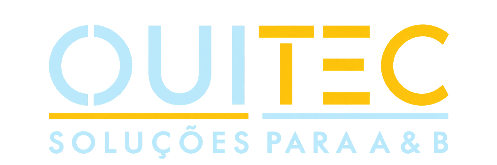

  

### Soluções tecnológicas inovadoras para o setor de Alimentos & Bebidas

Desenvolvemos software, integrações e automações que impulsionam a eficiência, a transformação digital e o crescimento de negócios do setor gastronômico.

---

## Tecnologias

Utilizamos um ecossistema tecnológico versátil para desenvolver soluções robustas, escaláveis e integradas.

---

## Sobre a OuiTec

Transformamos os desafios do setor de **Alimentos e Bebidas (A&B)** em oportunidades de crescimento por meio de soluções inteligentes, automação e inovação tecnológica.

Este espaço reúne nossos projetos de desenvolvimento de software, integrações, ferramentas e iniciativas de engenharia.

## Missão, Visão e Valores

<table>
  <tr>
    <th width="33%" align="center">MISSÃO</th>
    <th width="33%" align="center">VISÃO</th>
    <th width="34%" align="center">VALORES</th>
  </tr>
  <tr>
    <td align="center">
      <strong>Inspirar gestores</strong>
    </td>
    <td align="center">
      <strong>Desenvolver o futuro da gastronomia</strong>
    </td>
    <td align="center">
      <strong>Respeito, autenticidade, colaboração,
      responsabilidade, inovação, excelência e
      simplicidade.</strong>
    </td>
  </tr>
  <tr>
    <td align="center" valign="top">
      Atuar como agente inspirador de ideias e
      soluções para gestores gastronômicos.
    </td>
    <td align="center" valign="top">
      Agregar valores tecnológicos de forma
      sustentável em prol do futuro da gastronomia.
    </td>
    <td align="center" valign="top">
      Respeito ao próximo, autenticidade,
      colaboração, responsabilidade social,
      paixão por tecnologia e inovação com
      excelência e simplicidade.
    </td>
  </tr>
</table>

---

## Engenharia de Software

Nossa abordagem de desenvolvimento prioriza a construção de sistemas confiáveis, eficientes e preparados para evolução contínua.

| Área | Diretrizes |
|:---|:---|
| Arquitetura | Modularidade, desacoplamento e escalabilidade |
| Desenvolvimento | Código limpo, reutilização e manutenção |
| Integrações | APIs, interoperabilidade e automação |
| Qualidade | Testes, revisão de código e padronização |
| Segurança | Proteção de dados e controle de acesso |
| DevOps | Integração contínua e automação de entregas |

---

## Projetos e Recursos

<table>
<tr>
<td width="33%" valign="top">

### Repositórios

Explore nossos projetos e soluções desenvolvidas para o ecossistema de Alimentos e Bebidas.

[Ver repositórios](https://github.com/orgs/ouitec-br/repositories)

</td>
<td width="33%" valign="top">

### Documentação

Conheça nossos padrões, especificações e referências técnicas disponíveis.

[Explorar projetos](https://github.com/ouitec-br)

</td>
<td width="34%" valign="top">

### Site oficial

Conheça a OuiTec, nossas soluções e nossa atuação no setor de A&B.

[Acessar ouitec.com.br](https://ouitec.com.br/)

</td>
</tr>
</table>

---

**OuiTec | Soluções para A&B**

Tecnologia que transforma desafios em oportunidades.

[Website](https://ouitec.com.br/) · [Repositórios](https://github.com/orgs/ouitec-br/repositories)

© 2026 OuiTec. Todos os direitos reservados.

